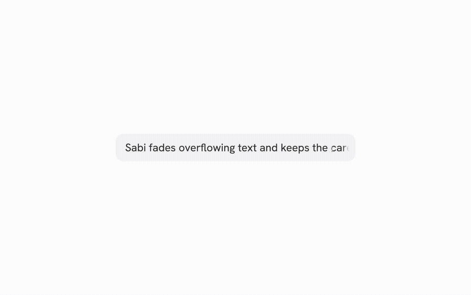

[Sabi](https://sabi.vicentecr.uz/) is a framework-independent input that smoothly fades overflowing text and keeps the caret visible.



[Watch the full-resolution demo](docs/media/sabi-demo.mp4?raw=true)

## Usage

Install it in your project:

```bash
npm install sabi-input
```

Import it once to register `<sabi-input>`, then wrap a text or password `<input>` with it (email and number fields stay plain: see [Email and number fields](docs/reference.md#email-and-number-fields)). An element before the input becomes a prefix; one after it follows the end of the text.

```html
<script type="module">import 'sabi-input';</script>

<label class="field">
  <sabi-input>
    <span>https://</span>
    <input name="url" />
  </sabi-input>
</label>
```

In React, use the `Sabi` component instead, with no other import:

```tsx
import { Sabi } from 'sabi-input/react';

<label className="field">
  <Sabi>
    <span>https://</span>
    <input name="url" />
  </Sabi>
</label>
```

## Submitting affixes

Add `submit-prefix` or `submit-suffix` to include that side in form data. Both are off by default.

```html
<label for="website">Website</label>
<sabi-input submit-prefix submit-suffix>
  <span>https://</span>
  <input id="website" name="website" value="example" />
  <span>.com</span>
</sabi-input>
```

The input still contains `example`; its form submits `https://example.com`. Empty inputs stay empty. Names shared by more than one control keep their native submission behaviour without added affixes.

In React, use the boolean props `submitPrefix` and `submitSuffix`:

```tsx
<Sabi submitPrefix submitSuffix>
  <span>https://</span>
  <input name="website" aria-label="Website" defaultValue="example" />
  <span>.com</span>
</Sabi>
```

Eligible text-like inputs keep a stable width by default, so their own native scrolling handles long values. Add `grow-input` to retain the measured, growing input behavior; this is useful for comparisons and caret-sensitive integrations. The older `stable-input` attribute is still accepted, but is no longer required. See the [input sizing reference](docs/reference.md#input-sizing).

Affixes come from the text of direct child elements before and after the input. Formatting whitespace between elements is ignored; whitespace inside an affix element is preserved. See the [submission reference](docs/reference.md#submitting-affixes) for the full contract.

## Documentation

Find the full API reference in the [documentation](https://sabi.vicentecr.uz/introduction).
